# 寺島家 昭和初期までの年表

## 住所
* 一番最初の住所は、東京市本郷区駒込曙町一番地
* 昭和5年10月20日 東京市本郷区駒込片町十二番地 に変更
* 昭和22年3月15日 行政区名の変更に伴い、東京都文京区駒込片町十二番地 に変更
* 昭和41年4月1日、第119号住居表示に関する法律により、東京都文京区本駒込一丁目十二番地 に変更
* 現在、東京都文京区本駒込一丁目二七番六号
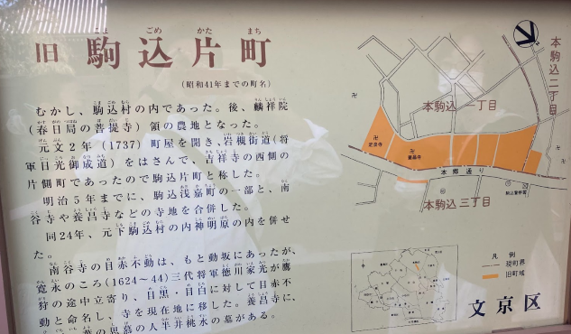

## 人物

### 寺島 安太郎（嘉衛3年？年？日～昭和5年10月2日）
* 富山県有沢村の長男として誕生
    * 現在の富山県富山市有沢付近で、神通川と井田川に挟まれた地域
* 次男 久次郎、三男 松三郎、長女 およね の4人兄弟の長男
* 1860年(万延元年)10歳の時に一家で上京。横浜市伊勢崎町弁天通の万屋（よろずや）という、履物屋に奉公に上がる
* 奉公に上がり、やがて自分の家を持ち、結婚。
* 株で儲けるものの、相場が急落し無一文になり、店をたたむ。また当時の妻とも離縁。
    * 時代的には、明治23年のいわゆる「明治23年恐慌」が該当すると思われる。
    * 第1次企業勃興により多くの会社が設立されたが、明治22年夏以降に、資本期の払い込みの集中や、米凶作による
    資金需要の急増で金融がひっ迫したことなどが要因。
* 巣鴨の保養院（精神病院）に飯炊きとなる。
    * 巣鴨にあった保養院と推測される。私立の「巣鴨脳病院（[東京古地図展](https://www.tsunagaru-map.com/pf-tokyo/map.html?map=5)）」というのがあった。大正時代の地図に大きく記載されていて、敷地1420坪、建物375坪、収容定員101名という大きな精神病院であったと思われる。
    * 太平洋戦争により、全焼し廃院となり、現在は住宅地となり痕跡も残ってはいない。  （[帝都を歩く](https://teitowalk.blog.jp/archives/81868565.html)）
* 病院での給料をもとに、草履を病院の上履きとして作り生計を立てる。
* 松尾 太兵衛 と ゑし の長女 として 明治39年9月20日 に、安太郎との婚姻届けが提出。同日、長男弥吉の認知届出も実施。
    * 結婚自体は明治33年ころに明保野町にて所帯を持った様子。
* 東大正門前から奥に入った、本郷森川町（現在の本郷6丁目付近と想定）の大地主の波多野家より、肴町と追分町の家作の管理と、
片町40軒の購入を勧められる。当初は断るものの、少しずつ納めればよいということで、苦労をして返済し入手。
    * 駒込肴町、追分町とは、現在の文京区向丘1、2丁目付近（[デジタル古地図 本郷区](https://adeac.jp/tokyo-23city/iiif/ct00000127/dg00000127/uv#?c=0&m=0&cv=0&r=0&xywh=1521%2C3216%2C4689%2C2093)）
    * デジタル古地図より、大正時代の本郷区 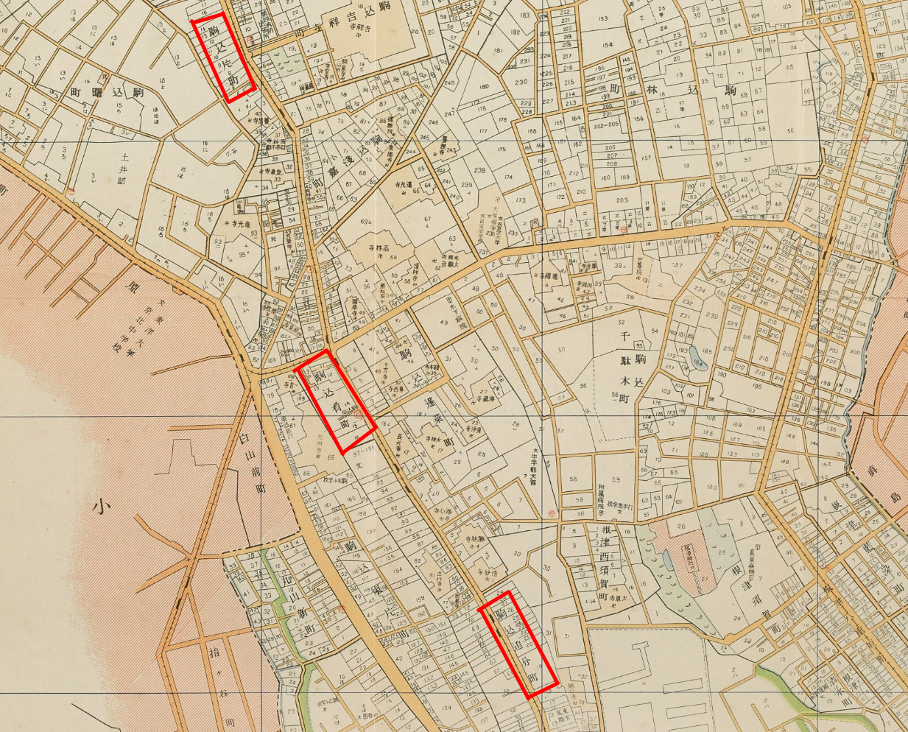
    * 駒込片町12番地がはっきりと見える。（[デジタル古地図 本郷区](https://adeac.jp/tokyo-23city/iiif/ct00000127/dg00000127/uv#?c=0&m=0&cv=0&r=0&xywh=1521%2C3216%2C4689%2C2093)）
     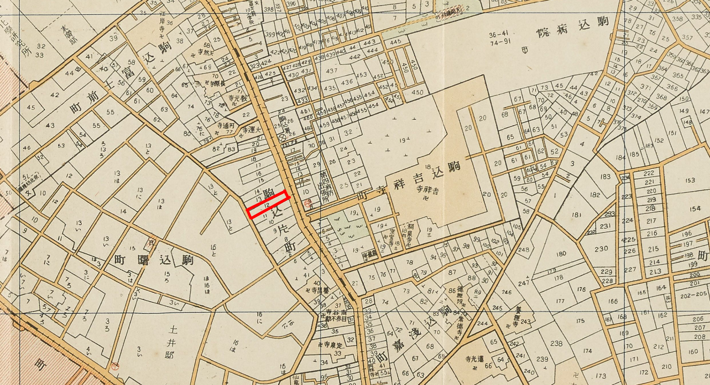
* 昭和5年10月2日 死去

### 寺島（松尾） ます（明治元年12月14日～昭和18年4月1日）
* 福井県大野郡大野町の広田家に生まれる。
* 幼少期に両親が離婚し、母親に引き取られる。
* 16歳の時に上京。神田に奉公に上がる
* 山本 千鳥という元士族と結婚。千鳥との間に、つなた、としぞうのほか、2人の女児をもうける。
* 女児2人は、子供のころに病死
    * 長男 つなた
        * 深川のヒデと結婚し、長男栄一を設ける。
        * つなたは遊び人であり、ヒデは愛想をつかして出ていき、長男 栄一は埼玉県蕨の知り合いに里子に出す。
        * つなた と ヒデは、のちに再開しやり直し、里子に出していた栄一を引き取る。
        * 飾り職人として生計を立てるものの、関東大震災で被災し避難先で、家族3人とも焼死したと思われる
        * 避難先を訪ねたものの、消息不明で、関東大震災の発生した 大正9月1日を家族の命日として扱われる。
    * 次男 としぞう
        * 駒本小学校に通い、その後旧制高等小学校にも通う。
        * やくざの道に入り、三河島の親分の子分になる。
        * ある時、寺島の親分、として訪ねてくるが、息子の弥吉が、戸籍にも入っていないことなどを説明し退ける。
* 明治39年9月20日 に、安太郎との婚姻届けが提出。同日、長男弥吉の認知届出も実施。
    * 結婚自体は明治33年ころに明保野町にて所帯を持った様子。
    * 戸籍上の両親は松尾 太兵衛 と ゑし の長女 となっている。
    * 生まれは、福井県大野郡大野町の「廣田」家であり、その後は山本姓になったと思われるが、戸籍上は「松尾」となっている。
    * 結婚当時は厩橋で奉公とのことで、奉公先が「松尾」だったのか。は推測。ただし、明治31年の旧民法制定までは「附籍」として奉公人などの同居人を、同じ1つの戸籍にしていたこともあった。
* 当時の松任駅前の吉田銀行支配人の吉田茂平とやり取りのあった、帰山という人から、石川県松任に弟である、「廣田 刈夫」がいることを知る。  
* 吉田茂平 吉田銀行創立者（[松任ふるさと館 HP](https://www.hakusan-museum.jp/furusato/) ） 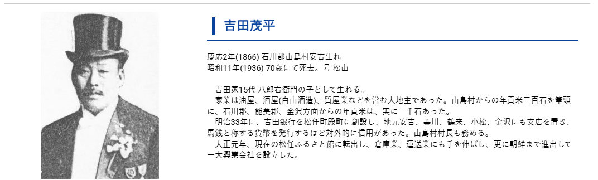 
* 手紙で連絡を取ると、弟である広田刈夫 は、当時の松任町の警察署長であった。
* 警察署長 廣田 刈夫 が記録（[石川県石川郡誌 102ページ](https://lab.ndl.go.jp/dl/book/1186712?page=67&keyword=)より）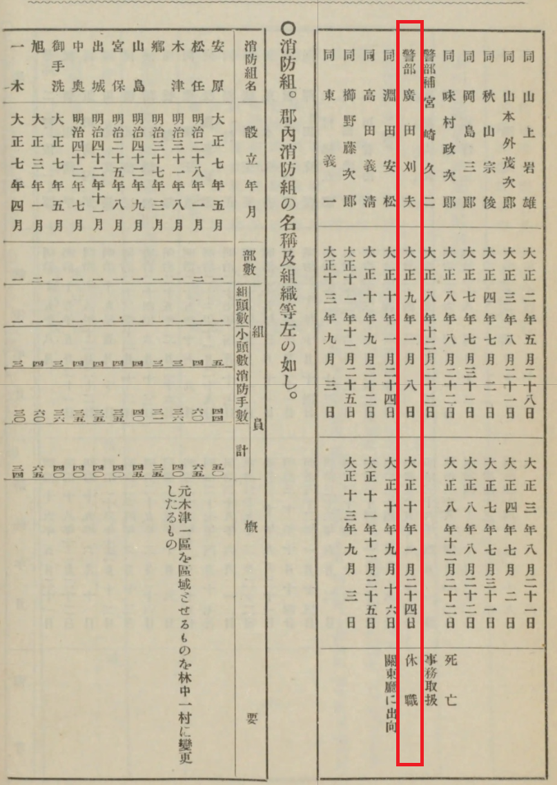 
* 廣田は、剣崎の東家と懇意であり、その経緯から、弥吉、伎久依のお見合いが成立し、結婚となる。
    * 廣田刈夫の娘の とき が、ます のつてを使い、曙町に居住。結婚して 山島姓 となる。
    * とき は みね子、茂穂の2人の子供があり、茂穂は東大に進学、その後東京女子大の教授などを歴任。
    * 茂穂は、代数学や幾何学を専攻。
    * 東大時代のセミナーノートが、古本で売られている。(￥13,000-)  （[日本の古本屋](https://www.kosho.or.jp/products/detail.php?product_id=321808968)）
    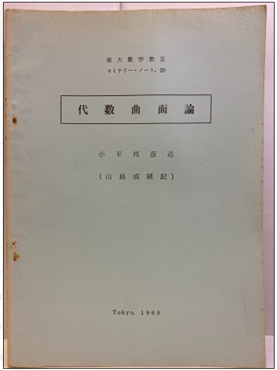

### 寺島 弥吉 (明治36年1月28日 生まれ) 
* 寺島 安太郎、ます の長男として生まれる
* 明治39年9月20日 本郷区駒込曙町1番地 認知届出
* 生まれから約3年半後に、認知届出
* 戸籍によると、寺島安太郎、ますとの婚姻届けの届け出とともに、戸籍の届出が行われる
* 届出は、山本鋼太により届出される。
    * 山本鋼太なるものは不明。
    * 母親にあたる「ます」の前夫が山本姓でもあり、関係あるかは不明。
* 昭和2年1月12日に、東 伎久依 との婚姻届けが提出
* 昭和5年10月2日、父 寺島 安太郎 死去により家督相続の届出があり、昭和5年10月9日に受理される。
* 昭和43年5月6日 午前4時32分 東京都文京区本駒込1丁目27番6号にて死去。4男の泰久により死亡届けが提出。

### 寺島（東） 伎久依（明治42年11月20日 生まれ）
* 東 治作、チエの二女として石川県石川郡林中村字剣崎西11番地で出生
    * 現在の石川県白山市剣崎町。田んぼ道にある県道174号を通ると、突如剣崎集落が現れる。
    * 2006年3月14日撮影（東家）
    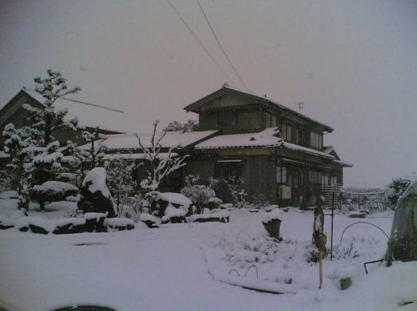
* 明治42年11月25日 出生届
    * 明治40年ころの松任駅（[松任ふるさと館 HP](https://www.hakusan-museum.jp/furusato/) ）
    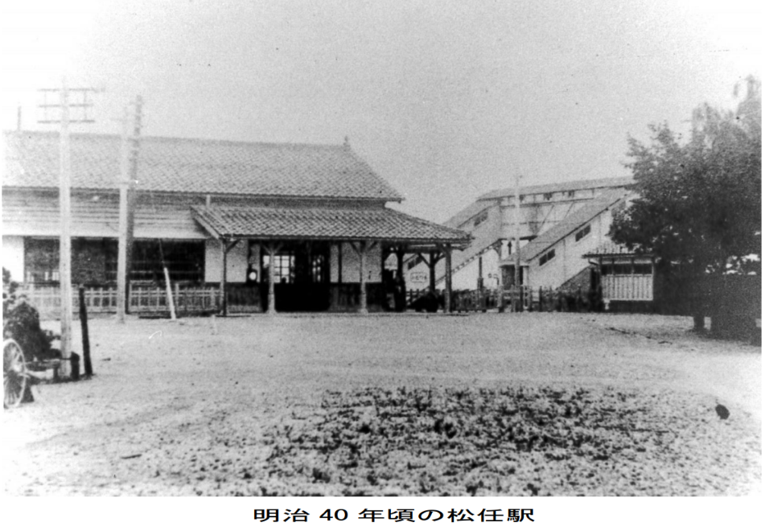
* 父親は、村長。
    * 石川県石川郡誌、[林中村より（資料では助役）826ページ](https://lab.ndl.go.jp/dl/book/1186712?page=443&keyword=)
    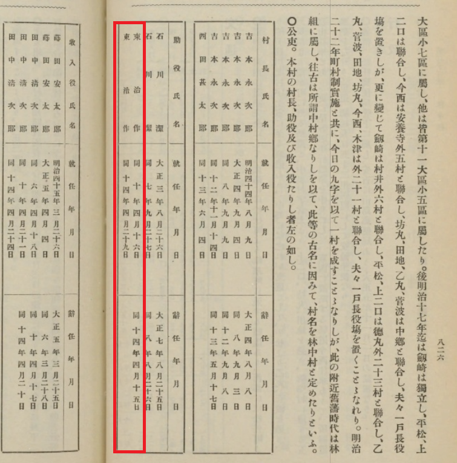
* 昭和2年1月12日に、寺島 弥吉 との婚姻届けが提出
* やす江、秀麿、睦子、麗二、良子、勝彦、泰久の4男3女を生む
* 平成12年7月4日 午前10時58分 東京都板橋区で死去。

### 寺島 國三郎（明治38年1月19日 生まれ）
* 寺島 安太郎、ます の次男として生まれる。
* 明治39年9月20日 本郷区駒込曙町1番地 認知届出
* 生まれから約1年半後に、認知届出
* 戸籍によると、寺島安太郎、ますとの婚姻届けの届け出とともに、戸籍の届出が行われる
* 届出は、山本鋼太により届出される。
* 森本 万之助。とめ の次女、二美枝と、昭和5年2月6日に婚姻届けが提出
* 昭和11年10月12日、分家に伴い除籍

### 寺島（森本） 二美枝（大正3年1月10日 生まれ）
* 福井県大野郡大野町大野東1番227号80番地 の戸主である、森本 万之助、とめ の次女として生まれる。
    * 住所に1番227号80番地 という変則的な記録になっているため、誤りの可能性あり。
    * 現在の福井県大野市になり、JR越前大野駅のある、おおよそ人口27000人（2026年現在）の都市。
* 寺島 國三郎と、昭和5年2月6日に婚姻届けが提出
* 二美枝は、「ます」の乳母である森本家の娘だった。

### 寺島 善次郎（明治39年9月22日 生まれ）
* 寺島 安太郎、ます の三男として生まれる。
* 明治39年9月25日 出生届出
* 大正6年5月17日に、芝区源助町十番地の戸主である、田中ふじ と養子縁組
    * 現在の新橋4丁目付近で、JRの線路脇。（[デジタル古地図 芝区](https://adeac.jp/tokyo-23city/iiif/ct00000121/dg00000121/uv#?c=0&m=0&cv=0&r=0&xywh=8655%2C2253%2C5303%2C2367)  ）
    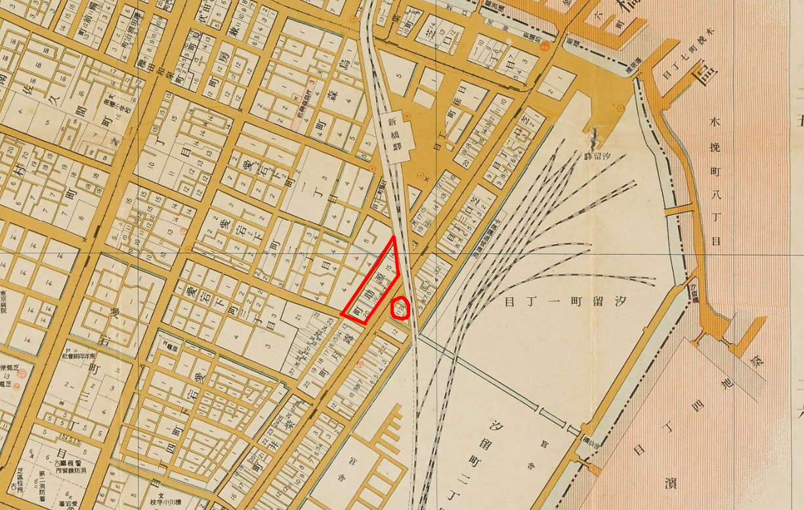

* 大正7年3月7日に、養父、田中ふじ と協議離縁
* 昭和9年3月14日に、田中 キチ と婚姻届出
* 昭和11年10月12日、分家に伴い除籍

### 寺島（田中） キチ（大正元年12月10日 生まれ）
* 栃木県河内郡雀宮村大字雀宮344番地 の戸主、田中豊三郎の長女 キチ と結婚し、昭和9年3月14日に婚姻届出
    * 栃木県河内郡雀宮村は、現在の宇都宮市雀宮町になる。おそらく今の雀宮駅近くと思われる。東北本線の雀宮駅があり、国道4号線と、国道4号バイパスに挟まれた
    地域であり、HKDインターパークや北関東自動車道、コストコなどのロードサイドのおおきなショッピングセンターが近くある
    宇都宮南部の地域。
* 昭和11年10月12日、分家に伴い除籍

### 安藤（寺島） 末子（明治44年5月10日 生まれ）
* 寺島 安太郎、ます の二女として生まれる。
* 明治39年9月25日 出生届出
* 明治44年5月5日に、出生届出
* 日本橋区濱町2丁目14番地 戸主の、安藤源蔵の長男、槍一郎と結婚し、昭和6年9月15日に婚姻届出
    * 日本橋区濱町2丁目14番地は、今の墨田川新大橋の近く。（[デジタル古地図 日本橋区](https://adeac.jp/tokyo-23city/iiif/ct00000119/dg00000119/uv#?c=0&m=0&cv=0&r=0&xywh=4044%2C3683%2C6841%2C3053)）
    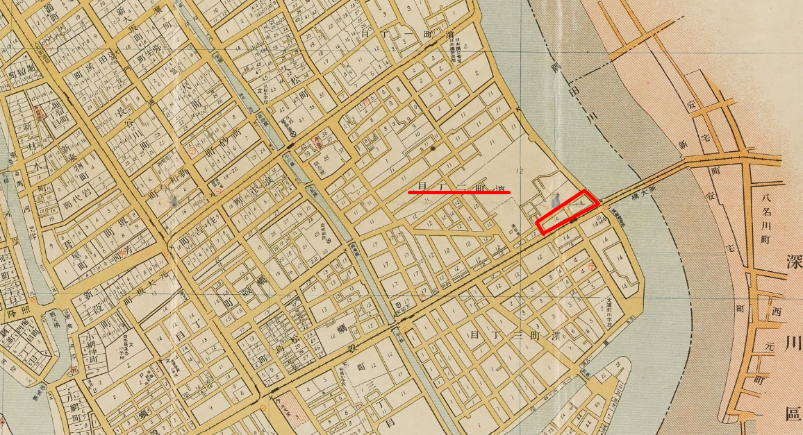
    * 付近には関東大震災でも他の橋が焼け落ちる中、大きな損害なく
    橋の上に避難した多くの人を救った、お助け橋とも呼ばれ、近くに震災避難記念碑（[まちひとサイト HP](http://machihito.blog131.fc2.com/blog-entry-2617.html)）がある。
    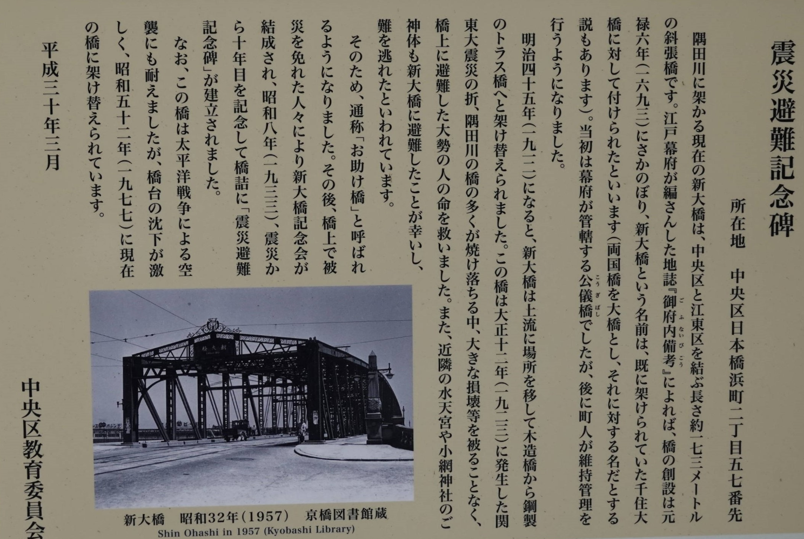
* 安藤家の実家は静岡
